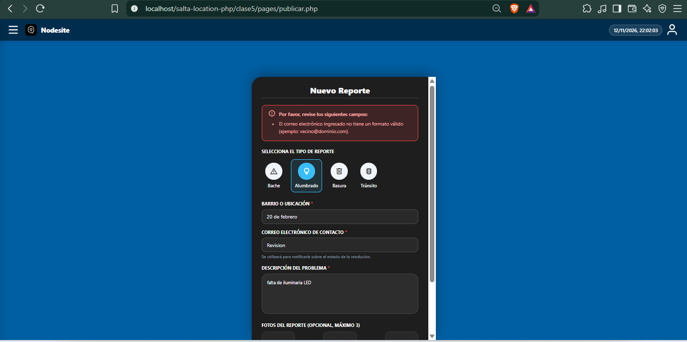
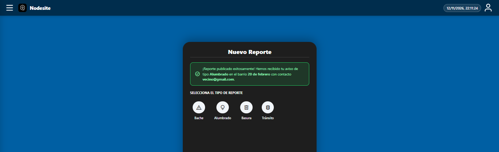
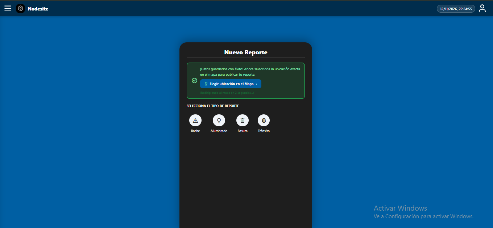
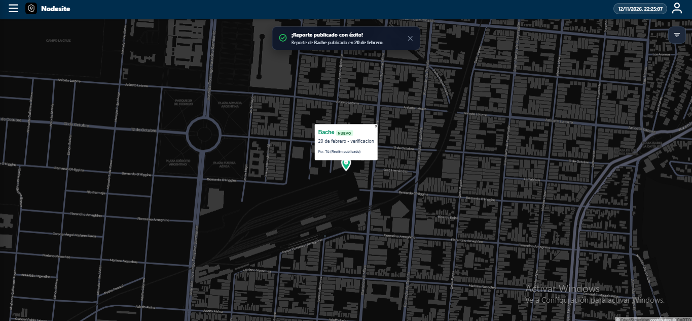
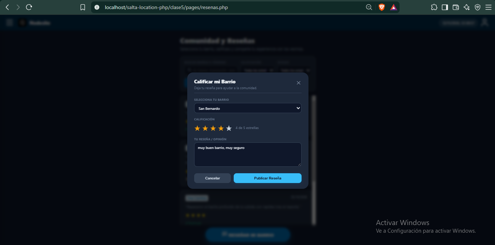
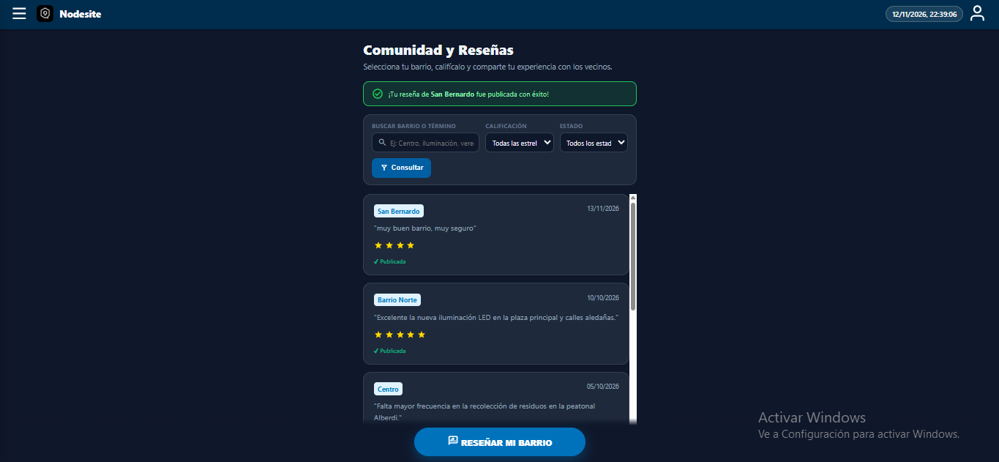
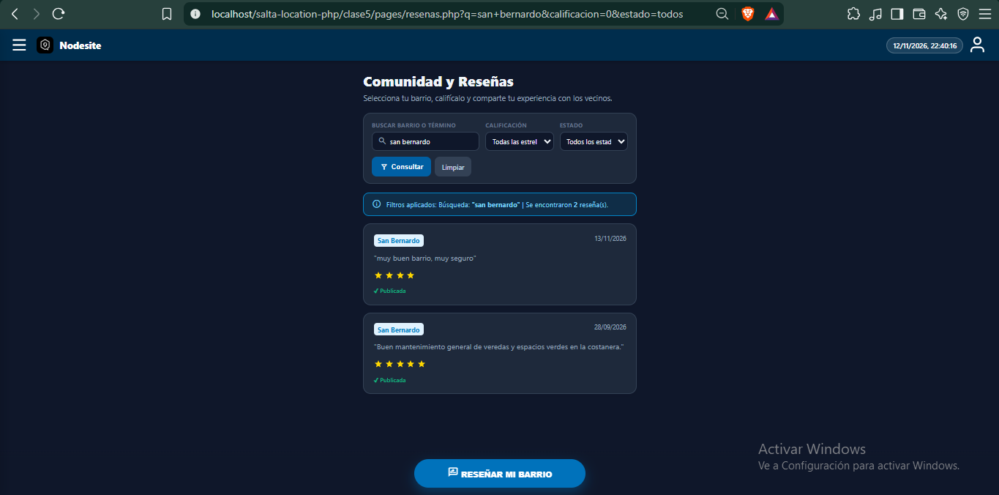
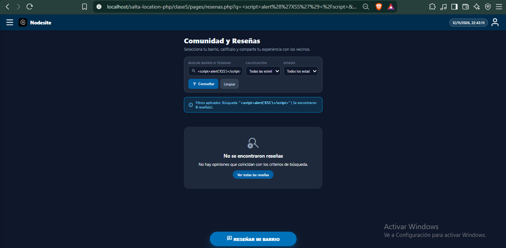
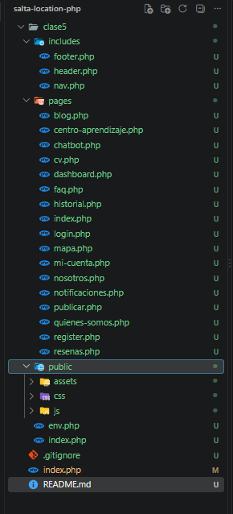

# NodeSite - Plataforma de Reportes Ciudadanos

## 1. Título y Descripción del Proyecto

NodeSite es una plataforma web orientada a la gestión, consulta y reporte de incidencias urbanas (baches viales, luminarias defectuosas, acumulación de residuos y señalización de tránsito) mediante un mapa interactivo y valoraciones de la comunidad.

**Resumen de la Refactorización a PHP (Unidad 4):**
El frontend de este proyecto fue concebido y desarrollado originalmente a lo largo del año académico como una Single Page Application (SPA) bajo el framework Angular. Con el propósito de cumplir estrictamente con los requerimientos pedagógicos de la materia, se llevó a cabo una migración integral y desde cero hacia un entorno nativo en PHP.

Este proceso de refactorización implicó:
* Reemplazar el sistema de enrutamiento y reactividad de componentes de Angular por una arquitectura modular en PHP basada en inclusión de archivos (`require_once` e `include`).
* Reescribir la totalidad de la lógica interactiva de la interfaz (carruseles de noticias, menús laterales, inicialización del mapa interactivo y apertura de modales) utilizando JavaScript puro (Vanilla JS).
* Adaptar el diseño a CSS3 nativo mediante hojas de estilo modulares por componente, manteniendo la fidelidad visual, la responsividad y el soporte completo de modo claro y oscuro sin depender de librerías externas como Bootstrap.

---

## 2. Enlace al Prototipo de Figma

El diseño base de la interfaz y la maqueta funcional se encuentran documentados en Figma:
* **Enlace:** [Pegar enlace de Figma aquí]

---

## 3. Tecnologías Utilizadas

*  **PHP 8.x**: Renderizado del lado del servidor, arquitectura modular, captura y procesamiento seguro de peticiones HTTP.
*  **JavaScript (Vanilla)**: Manipulación dinámica del DOM, interactividad de componentes, geolocalización y consumo de APIs de mapas.
*  **HTML5**: Estructuración semántica y accesible de formularios y vistas.
*  **CSS3 Nativo**: Estilos personalizados, variables CSS, animaciones fluidas, diseño adaptativo (Mobile First) y tema oscuro/claro persistente.
* **MapLibre GL JS**: Renderizado vectorial y gestión de capas y marcadores en el mapa interactivo.
* **XAMPP / Laragon**: Entorno de ejecución de servidor local con Apache y PHP.

---

## 4. Instrucciones de Instalación y Ejecución Local

Para ejecutar el proyecto localmente, seguir los siguientes pasos:

1. **Requisitos previos:** Contar con un entorno local como **XAMPP** o **Laragon** con soporte para PHP 8.x.
2. **Clonación del repositorio:** Descargar o clonar este proyecto dentro de la carpeta pública del servidor web:
   * En XAMPP: `C:\xampp\htdocs\`
   * En Laragon: `C:\laragon\www\`
   
   ```bash
   git clone https://github.com/hugozolor/NodeSITE-PHP.git
   ```
3. **Inicio de servicios:** Abrir el panel de control de XAMPP o Laragon e iniciar el servicio de **Apache**.
4. **Acceso web:** Ingresar desde cualquier navegador a la siguiente dirección:
   
   ```text
   http://localhost/NodeSITE-PHP/
   ```
   *(La raíz redirige de forma transparente al desarrollo de la entrega en `clase5/`).*

---

## 5. Clase 5: Seguridad Web, Procesamiento de Formularios y Prevención de XSS

En esta unidad se incorporó la lógica del lado del servidor para capturar, validar y procesar datos enviados desde el navegador, aplicando directivas defensivas contra vulnerabilidades de Cross-Site Scripting (XSS) según las pautas de OWASP Top 10. 

Todo el desarrollo correspondiente a esta entrega reside íntegramente dentro de la carpeta **`clase5/`**, manteniendo una estructura desacoplada y libre de archivos redundantes.

### A. Implementación de Formularios

#### 1. Formulario de Envío por POST (`clase5/pages/publicar.php` y `resenas.php`)
Diseñado para la captura, alta y procesamiento de información enviada por los ciudadanos:
* **Alta de Reporte Urbano (`publicar.php`):**
  * `tipo_reporte`: Selector de incidencia (Bache, Alumbrado, Basura, Tránsito).
  * `barrio`: Campo de texto obligatorio para la zona o calle del incidente.
  * `email`: Correo de contacto del vecino, con validación formal en servidor.
  * `descripcion`: Detalle descriptivo de la situación (mínimo 10 caracteres).
  * Tras procesarse el POST, el sistema conduce al usuario al mapa en modo interactivo para que determine la coordenada geográfica exacta del reporte.
* **Alta de Reseña Comunitaria (`resenas.php`):**
  * `barrio_resena`: Selector desplegable de barrios de Salta.
  * `estrellas_resena`: Calificación numérica de 1 a 5 estrellas.
  * `comentario_resena`: Opinión sobre los servicios y estado del barrio.

#### 2. Formulario de Envío por GET (`clase5/pages/resenas.php`)
Diseñado para la consulta, búsqueda y filtrado dinámico de valoraciones:
* **Parámetros GET:**
  * `q`: Búsqueda libre por coincidencia de texto en nombre de barrio o contenido del comentario.
  * `calificacion`: Filtro por cantidad exacta de estrellas asignadas (1 a 5).
  * `estado`: Filtro por estado de moderación (Todas, Publicadas, En Revisión).

---

### B. Sanitización Estricta y Seguridad (OWASP Top 10 - XSS)

Para neutralizar la inyección de código ejecutable malicioso (XSS) y proteger los datos recibidos:

1. **Uso riguroso de `htmlspecialchars()`:** Se aplica `htmlspecialchars($variable, ENT_QUOTES, 'UTF-8')` sobre todas las entradas capturadas por `$_POST` y `$_GET` antes de su procesamiento o renderizado, transformando caracteres críticos (`<`, `>`, `&`, `"`, `'`) en entidades HTML inocuas.
2. **Normalización con `trim()`:** Eliminación de espacios en blanco iniciales y finales en cadenas de texto para impedir registros de información vacía o manipulada.
3. **Validación tipada con funciones nativas:**
   * `filter_var($email, FILTER_VALIDATE_EMAIL)`: Valida la sintaxis correcta del correo electrónico en el servidor.
   * `filter_input(INPUT_GET, 'calificacion', FILTER_VALIDATE_INT)`: Fuerza a que el parámetro de calificación sea numérico entero.
4. **Validaciones de servidor:** Verificación de obligatoriedad con `empty()` e `isset()`, y control de longitud mínima con `mb_strlen()`.

---

### C. Retroalimentación en la Interfaz y Persistencia de Datos

1. **Mensajes Informativos y Alertas:**
   * En caso de error de validación en POST, se presenta una caja de alerta destacada detallando las inconsistencias encontradas.
   * En caso de éxito, se despliega una alerta verde confirmando el procesamiento de los datos.
   * En las consultas GET, se muestra un banner informativo con el recuento exacto de resultados encontrados y los filtros aplicados.
2. **Persistencia de Datos:**
   * Si el usuario comete un error al enviar el formulario POST, los campos completados conservan los valores ingresados (`value="<?= ... ?>"`) para evitar la pérdida de información.
   * En el formulario GET, los inputs y selects conservan los términos buscados y las opciones marcadas tras la consulta.

---

### D. Evidencia Funcional y Capturas de Pantalla

A continuación se documenta el funcionamiento en tiempo de ejecución de todos los componentes requeridos:

#### 1. Formulario POST: Validación de Errores y Persistencia (`publicar.php`)
Al ingresar datos que no superan las validaciones del servidor (correo con formato inválido o campos incompletos), se despliega la alerta roja de validación y los campos conservan los datos escritos previamente.


#### 2. Formulario POST: Procesamiento Exitoso (`publicar.php`)
Al completar los datos correctamente y enviarlos mediante POST, el servidor registra la información y muestra el banner verde de confirmación con los datos procesados.


#### 3. Interacción con el Mapa: Selección de Ubicación del PIN
Tras validar el reporte, el usuario es guiado al mapa interactivo donde puede seleccionar haciendo clic en la ubicación geográfica precisa del incidente.


#### 4. Visualización del Reporte Publicado en el Mapa
Una vez confirmada la ubicación, el pin queda fijado en el mapa con su ventana emergente informativa y se despliega la notificación de confirmación.


#### 5. Listado de Comunidad y Reseñas (`resenas.php`)
Visualización de las opiniones ciudadanas sobre el estado y los servicios de distintos barrios de la ciudad.


#### 6. Modal Interactivo para Calificar y Dejar Reseña (`resenas.php`)
Formulario modal para que el usuario seleccione su barrio, otorgue una puntuación con estrellas interactivas y redacte su comentario.


#### 7. Formulario GET: Búsqueda y Filtrado Dinámico (`resenas.php`)
Filtrado en tiempo real en el servidor mediante parámetros de consulta GET, mostrando la URL actualizada y la barra de filtros activos con los resultados encontrados.


#### 8. Prueba de Seguridad contra Ataques XSS (`resenas.php`)
Demostración de sanitización de entradas frente a un intento de inyección de código (`<script>alert('XSS')</script>`), el cual es neutralizado y renderizado como texto inofensivo.


#### 9. Estructura de Directorios Requerida en `clase5/`
Organización modular del proyecto en Visual Studio Code, verificando que la totalidad del desarrollo de la entrega reside dentro de la carpeta `clase5/`.

